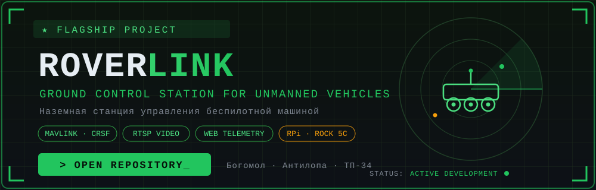

<div align="center">




</div>

## Проекты HAUGER IT

| Проект | Публичная витрина на GitHub | Сайт | Статус |
|---|---|---|---|
| **RoverLink** — станция на наземной машине | [Открыть RoverLink](https://github.com/xaker-enginer/roverlink) | [hauger-it.com/roverlink](https://hauger-it.com/roverlink/) | ТП-34 внедрён, испытания прошли успешно |
| **RoverLink НСУ** — программа оператора для Windows | [Описание НСУ](https://github.com/xaker-enginer/roverlink/blob/main/docs/nsu.md) | [hauger-it.com/nsu](https://hauger-it.com/nsu/) | 0.1.0-beta2 |
| **GCS-G** — наземная станция БПЛА | [Открыть GCS-G](https://github.com/xaker-enginer/gcs-g) | [hauger-it.com/gcs-g](https://hauger-it.com/gcs-g/) | Стендовая разработка, 0.7.4-dev |
| **Рельеф** — карты, высоты и радиолинии | [Открыть Рельеф](https://github.com/xaker-enginer/relief) | [hauger-it.com/relief](https://hauger-it.com/relief/) | Нативные Android и iOS, beta13 |

НСУ — отдельный проект; его публичное описание пока размещено в витрине RoverLink.
Исходники НСУ, GCS-G и нативного «Рельефа» хранятся в закрытых репозиториях.

```
┌──────────────────────────────────────────────────────────────┐
│  > whoami                                                    │
│  Dmitry Prokofev [XAKER] — Robotics Engineer                 │
│  > mission                                                   │
│  Building ground control systems for unmanned vehicles       │
│  > status                                                    │
│  ● ONLINE — LINK SECURE — MODE: AUTONOMOUS                   │
└──────────────────────────────────────────────────────────────┘
```

## `▌ ABOUT // О СЕБЕ`

**EN** — Robotics engineer focused on **unmanned ground vehicles (UGV)**. I design and build ground control stations that run on single-board computers — from protocol translation (MAVLink / CRSF / SBUS) and low-latency video pipelines to web-based control panels with real-time telemetry. Open-source core, commercial-grade reliability.

**RU** — Инженер-робототехник, специализируюсь на **беспилотных наземных машинах**. Проектирую и разрабатываю наземные станции управления на одноплатных компьютерах: трансляция протоколов (MAVLink / CRSF / SBUS), видеопотоки с низкой задержкой, веб-панель управления с телеметрией в реальном времени. Открытое ядро — надёжность коммерческого уровня.

```python
class RoboticsEngineer:
    name     = "Dmitry Prokofev"
    callsign = "XAKER"
    focus    = ["UGV", "ground control stations", "telemetry", "video streaming"]
    hardware = ["Raspberry Pi 4/5", "Radxa ROCK 5C", "ESP32", "flight controllers"]
    mission  = "reliable control links for unmanned machines"
```

## `▌ FLAGSHIP PROJECT // ФЛАГМАНСКИЙ ПРОЕКТ`

<div align="center">

<a href="https://github.com/xaker-enginer/roverlink">

</a>

</div>

### RoverLink — бортовая станция наземной машины

Связывает Mission Planner, камеры и систему управления машины. Raspberry Pi
и Radxa ROCK 5C, веб-панель, RTSP-видео, диагностика и удалённая связь через ZeroTier.

**Три платформы и четыре режима:** Богомол B5 без полётного контроллера,
Богомол B5 с полётным контроллером, Антилопа 4×4 и ТП-34.
**ТП-34 внедрён; испытания прошли успешно.** Для него развивается отдельная
ветка с микшером дневных, ночных и задних камер и аппаратным кодированием видео.

[Публичная витрина RoverLink](https://github.com/xaker-enginer/roverlink) ·
[Проект на сайте](https://hauger-it.com/roverlink/)

Основная разработка хранится в приватном репозитории. Специализированные
ветки поставляются отдельно; номер бета-сборки не означает новый стабильный релиз.

## Другие проекты HAUGER IT

### RoverLink НСУ — приложение оператора для Windows

Отдельный проект поста управления: поиск станции, RTSP H.264/H.265,
выбор и калибровка HID-пульта, назначение каналов и передача MAVLink.
Видеокомпоненты входят в автономный установщик.

**0.1.0-beta2:** программные проверки выполнены; проверка с физическим
пультом и машиной ещё предстоит. Исходники приватные.

[Возможности и статус НСУ](https://github.com/xaker-enginer/roverlink/blob/main/docs/nsu.md)

### GCS-G — наземная станция для БПЛА

Raspberry Pi 5, веб-панель, RC/CRSF через Pico, управление видеоприёмником,
USB-захват и RTSP H.264. Сканер 40 каналов для совместимого приёмного тракта.

**0.7.4-dev, стендовая разработка.** Подтверждены отдельные проверки
управления и видео; полётные испытания и проверка failsafe реального борта
не объявляются завершёнными. Исходники приватные.

[Публичная витрина GCS-G](https://github.com/xaker-enginer/gcs-g)

### Рельеф — карты, высоты и радиолинии

Нативные Android и iOS: офлайн-карты и рельеф, профиль радиолинии и зона
Френеля, свои точки и маршруты, координаты СК-42 и WGS-84, обмен GPX/KML,
управление ротатором мачты по Wi-Fi.

**beta13:** Android — основная платформа; iOS — нативное приложение с
установкой подписанного IPA. Старая веб-версия заморожена. Исходники приватные.

[Публичная витрина Рельефа](https://github.com/xaker-enginer/relief)

## `▌ TECH STACK // СТЕК`

<div align="center">

**` SOFTWARE `**


**` PROTOCOLS & COMMS `**


**` HARDWARE & OS `**


</div>

## `▌ TELEMETRY // СТАТИСТИКА`

<div align="center">


</div>

## `▌ COMMS // СВЯЗЬ`

<div align="center">

[](https://t.me/dmitry_haker)
[](mailto:dmitry@hauger-it.com)

<br/>

```
> EN: Open to collaboration on UGV / robotics / ground control projects.
> RU: Открыт к сотрудничеству по проектам UGV, робототехники и наземных станций управления.
```


</div>

<div align="center">
<sub><code>// end of transmission ●</code></sub>
</div>
